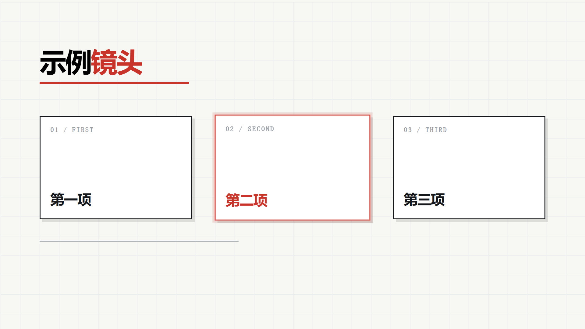

# Explainer Motion Pipeline · 讲解动画管线

**中文** · [English](README.en.md)



把一段口播文案变成**能交付的动效片段**：一镜一页 HTML，逐帧渲染成 4K 视频，带配音。
两条纪律撑起整件事——**可判**（每镜必须过两道机器闸）和**不像 AI**（靠取舍而不是补齐）。

> 在线预览：<https://mlf631666711-cloud.github.io/explainer-motion-pipeline/>

---

## 这东西解决什么问题

用 AI 做讲解动画，最容易做出来的不是"难看的片子"，是**一眼假的片子**：

| 症状 | 你以为的问题 | 真正的问题 |
|---|---|---|
| 每个元素都是淡入 | "动效不够丰富" | 你没给动作**方向**，淡入是"没有动效的动效" |
| 元素进完就定住，等旁白 | "节奏拖了" | 画面里没有**第二段动作**，观众在等你 |
| 一屏塞满卡片和图标 | "信息太少" | 你没有**取舍**，一屏该只有一个主角 |
| 角落里那行 24px 小字 | "补充说明" | 那是**替旁白编内容**，最典型的 AI 味 |
| 圆角 + 渐变 + 发光 | "现代感" | 那是模型训练数据里的**默认值** |

这个仓库给的是**判据 + 模板 + 尺子**，不是"审美"。丑不丑还得你看，但"空不空、死没死、越没越界、像不像机器凑的"——全都能机器判。

## 三个来源，一句话

> **AI 味 = 默认值 + 平均化 + 过度解释。**
> 默认值：不假思索选最常见的视觉（圆角/渐变/发光/居中）。
> 平均化：等间距、等时长、等权重——真人靠**对比**，模型挑**中位数**。
> 过度解释：怕信息不足，于是替观众把话说完。
> ⇒ **减少 AI 味 = 主动删掉一半。**

完整版见 [`references/anti-ai-taste.md`](references/anti-ai-taste.md)（含四层准则与 60 秒自检）。

## 仓库结构

```
.
├── SKILL.md                      # 技能主文件（五步流 / 硬契约 / 十条速查 / 反模式）
├── references/
│   ├── anti-ai-taste.md          # ★ 去 AI 味：三来源 + 四层准则 + 自检清单
│   ├── motion-vocabulary.md      # 动效十二式（每式带可直接粘的代码）
│   ├── layout-system.md          # 安全区 / 字阶 / 色彩 / 硬边卡 / 实拍图处理
│   ├── qa-gates.md               # 两道闸的口径与阈值 + 判据骗人的四种方式
│   └── recording-enhance.md      # 录屏包装：定框 + 框内推近 + 侧栏要点
├── scripts/
│   ├── density_check.cjs         # 闸①：画面在不在动（内容事件/秒、最长静默）
│   ├── safe_check.cjs            # 闸②：内容在不在框里、横向够不够满
│   ├── render.cjs                # HTML → 视频（逐帧 render(t)，默认 4K）
│   ├── render-record.cjs         # 带 <video> 的录屏美化页 → 视频（逐帧 seek）
│   └── probe.cjs                 # 抽几帧用眼睛过
├── assets/
│   └── shot-template.html        # ★ 起手模板（开箱即过双闸）
├── recording/                    # ★ 自动录屏：真浏览器 + 真光标（Windows）
│   ├── rec_web.py                # 一条命令：起浏览器 → 量坐标 → 开录 → 真鼠标点
│   ├── web_drive.cjs             # 有头 Chrome + 取 DOM 矩形 + 插红块做校准
│   ├── calib.py                  # 抓帧找红块 = 视口原点（像素级校准）
│   ├── auto_record.py            # 区域录制 + 驱动真鼠标 + 预热/哨兵
│   └── mouse.py  record_mode.ps1
├── index.html                    # 在线预览页
└── preview.png
```

## 5 分钟上手

```bash
# 0) 依赖：node + Chrome + ffmpeg + puppeteer-core
npm i puppeteer-core            # 或指向任意已装它的 node_modules

# 1) 复制模板改成你的内容
cp assets/shot-template.html my-shot.html

# 2) 过闸（不过闸不渲）
node scripts/density_check.cjs "my-shot.html"
node scripts/safe_check.cjs    "my-shot.html" --step 0.5

# 3) 抽帧用眼睛过
node scripts/probe.cjs "my-shot.html" "2,4,5.4" _p

# 4) 渲 4K（有配音就给 mp3，没有就写 - ）
node scripts/render.cjs "my-shot.html" 6.0 voice.mp3 "out/my-shot-4K.mp4"
```

`DEVICE_SCALE=2`（默认）⇒ 1920×1080 的页面出 3840×2160。

## 三件硬契约

| 契约 | 值 | 为什么 |
|---|---|---|
| `#stage` | 1920×1080 | 所有内容绝对定位其内，渲染视口与它一致 |
| `window.DUR` | 本镜秒数 | 闸门靠它决定采样范围；必须等于配音时长（±0.02s） |
| `render(t)` | **纯函数** | 只依赖 t、不读上一帧状态 ⇒ 可任意 seek、可逐帧重渲、两次渲出来逐字节一致 |

## 两根尺子

**闸① `density_check`** —— 抓"空"和"死"

| 读数 | 阈值 |
|---|---|
| 可见对象数 | ≥ 12 |
| 内容事件 / 秒 | ≥ 3 |
| 内容最长静默 | ≤ 1.2s |

> 计量件（网格、进度线）必须标 `class="meter"`：它们只报读数，**不算内容事件**——
> 否则一条全程进度线就能把静默"填平"，屏幕一片空白也全绿。

**闸② `safe_check`** —— 抓"越界"和"缩水"

| 判据 | 阈值 |
|---|---|
| 竖向 | 内容 ∈ `y∈[154, 926]`（上 154 给进度条，下 154 给字幕） |
| 横向 | 内容包围盒 ≥ 1600px（1920 的 83%） |

> 横向阈值取 1600 而不是 1920：版式本来就需要 ~150px 编辑边距。
> 但"整体 `scale()` 缩小居中"只剩 1372（71%），必须被拦下——这个坑真实发生过，整批片重排。

**闸门报 PASS 而你觉得不对 ⇒ 先怀疑闸门。** 这两个脚本都写过"自证"级别的 bug，详见
[`references/qa-gates.md`](references/qa-gates.md)。

## 自动录屏（Windows）

讲解片里常有"真人操作软件"的镜头。无头渲染没有鼠标，软件光标是画上去的——两者都会露馅。
`recording/` 反过来做：**结构归 DOM，手势归 OS，判据归像素**。

> **最近更新 · 2026-10-22**：打字全部改走 `SendInput` 的 Unicode 通道 —— 中文、反斜杠、`%` 这类符号不再被输入法吃掉
> （12 个字 20–32ms）。新增 `typefast` / `typehuman` / `paste` 三个动作；`focus()` 修掉「抢不到前台却报窗口不存在」的误报。
> 实测矩阵见 [`recording/键盘与快速输入.md`](recording/键盘与快速输入.md)，每轮改动见 [`recording/CHANGELOG.md`](recording/CHANGELOG.md)。

```bash
set NODE_PATH=C:\path\to\node_modules        # 需要 puppeteer-core
python recording/rec_web.py --url "https://example.com/setup" --steps my_steps.json --out out/r01.mp4
```

一条命令完成：起有头 Chrome → 取元素矩形 → **在页面左上角插一个 12×12 红块** → 抓帧找红块算出视口原点 →
`gdigrab` 区域录制 → 按脚本驱动真鼠标点击。

五个坑全写在 [`recording/README.md`](recording/README.md)，共同点是**都不报错**：
窗口被最大化录到 1/4、第一次点击被系统当成"激活窗口"吃掉、用 `outerHeight−innerHeight` 估坐标偏 8–39px、
`reload()` 把 URL hash 里的 tab 状态恢复回去、`goto()` 在错误页上也返回成功。

> 录完只是原料。要变成讲解段（定框 + 框内推近 + 侧栏要点 + 音画对齐），见
> [`references/recording-enhance.md`](references/recording-enhance.md)。

## 动效十二式（节选）

完整代码见 [`references/motion-vocabulary.md`](references/motion-vocabulary.md)。

| # | 手法 | 一句要点 |
|---|---|---|
| 1 | 遮罩滑入 | 容器 `overflow:hidden` + `translateY(104%)`，比淡入高级十倍 |
| 2 | 错峰落位 | 组内 0.12–0.20s，**组与组按语义断开**（不是 `i*0.5`） |
| 3 | 落位回弹 | `ob()` + `scale 0.94→1` |
| 4 | **点亮** | 描边 + 光晕 + 饱和 + 放大**四通道同时变**，只改颜色是"变色"不是"点亮" |
| 5 | 划线 | `eio` 0.7–1.0s |
| 6 | 路径绘制 | `strokeDashoffset` 总长 → 0 |
| 7 | 数字/点阵填充 | 数字与图形**同步**到 |
| 8 | 框内推镜 | 取景框固定，只动框内 `transform`，**中心要 clamp 否则露白边** |
| 9 | 分屏滑移 | 视窗**略窄于页宽**，否则下一页露边 |
| 10 | 迁移线 | 线扫到哪，哪里的节点才变红——**有因果** |
| 11 | 括号收拢 | 把一排元素括起来说"同一类" |
| 12 | 收尾定格 | 最后一拍减速到 0 并 hold ≥0.5s |

## 去 AI 味十条（速查）

1. **不自造总结小字**：屏上只留「旁白原词 / 结构标签 / 界面内容」；要总结就用 ≥54px 标题或整块色块。
2. **不只做淡入**：位移、点亮、划出、推近至少来一个；纯 `opacity` 只用于退场。
3. **不要一律 300ms ease-in-out**：急停 0.22–0.3s、落位 0.45–0.6s、慢推 0.8–1.4s，同拍不等长。
4. **不要等间隔落位**：`i*0.5s` 是节拍器；按语义分组。
5. **允许静止，但别超 1.2 秒**：hold 是节拍，死帧是事故。
6. **换掉默认视觉**：不要圆角+渐变+发光；用纸面底、硬边、硬投影、单一强调色。
7. **拒绝绝对对称**：一屏一个主角，允许偏心与破格。
8. **图标只在需要识别处用**：一排图标配一排字是最典型的 AI 排版。
9. **动作要有因果**：线扫到哪、哪里的节点才变红；落下要"砸"出反应。
10. **不默认加总结页**：旁白没总结，画面就别总结；用落版收尾。

## 安装成 WorkBuddy / Claude 技能

把仓库放进技能目录即可，`SKILL.md` 的 frontmatter 会被自动识别：

```bash
git clone https://github.com/mlf631666711-cloud/explainer-motion-pipeline \
  ~/.workbuddy/skills/explainer-motion-pipeline
```

之后对话里说「做一段讲解动画」「这个画面太空」「把这段文案变成动画」就会加载它。

## 适用 / 不适用

✅ 讲解、科普、教程视频的分镜动效；概念可视化（对比/流程/谱系/因果/时间轴）；把录屏包装成讲解段；**自动录制真人操作网页的过程（Windows）**。
❌ 真人实拍；需要 3D 建模的镜头；纯剪辑拼贴。

## 许可

MIT，见 [LICENSE](LICENSE)。仓库内所有图形均由代码生成，`assets/shot-template.html` 可直接商用改作。

---

*做这套东西的起因：连续几轮交付里，机器判据全绿，人一眼还是看出"这是 AI 凑的"。
后来发现假绿总出在两处——尺子只测了"多"没测"少"，和"平均"冒充了"设计"。*
